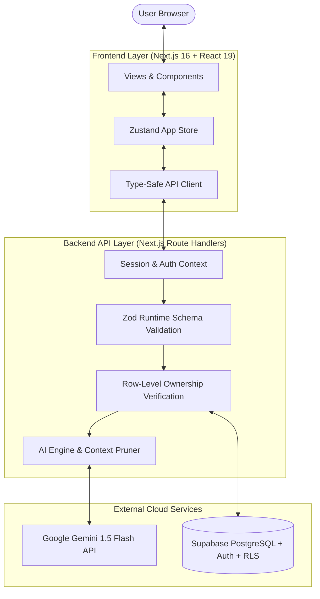

# UtsavAI — Intelligent Celebration & Event Planner

> **"Plan celebrations smarter."**  
> An AI-assisted Celebration & Event Planning platform designed for weddings, milestone birthdays, community festivals, and family gatherings.

[](https://nextjs.org/)
[](https://www.typescriptlang.org/)
[](https://supabase.com/)
[](https://deepmind.google/technologies/gemini/)
[](https://tailwindcss.com/)
[](LICENSE)

---

## 1. Hackathon Executive Summary

### The Problem
Organizing Indian and multi-day cultural celebrations (such as weddings, milestone 50th birthdays, and community festivals) is notoriously stressful and fragmented. Organizers balance shifting guest lists, complex multi-vendor negotiations, unpredictable cash flows, and tight day-of ceremony schedules across disconnected notes, spreadsheets, and chat groups. Existing generic project tools lack cultural celebration context, while traditional event software is rigid and devoid of intelligent advisory support.

### The Solution: UtsavAI
**UtsavAI** combines a modern, responsive web application with a context-aware AI Co-Pilot powered by **Google Gemini 1.5 Flash** and a multi-tenant PostgreSQL database via **Supabase**. UtsavAI bridges high-level celebration visions with low-level execution:
1. **Dynamic Plan Generation:** Converts dates, budgets, guest headcounts, and cultural preferences into tailored multi-week checklists, vendor recommendations, and day-of run-of-show schedules.
2. **Deterministic Financial & Operational Boundaries:** Keeps all budget arithmetic, date clampings, and dependency chains strictly in deterministic TypeScript code to ensure zero hallucinations in calculations.
3. **Context-Grounded Advisory Assistant:** Answers queries specifically grounded in live event data (e.g. *"What should I prioritize this week?"*, *"Am I over budget on catering?"*) with zero client secret exposure.

---

## 2. Core Features

- 🎪 **Multi-Event Management:** Track weddings, birthdays, community galas, family celebrations, and custom events simultaneously with distinct theme styles and priorities.
- 💰 **Intelligent Budget & Expense Tracking:** Real-time variance tracking between planned and actual costs, category allocations (Venue, Catering, Decor, Photography), and instant over-budget risk indicators.
- ✅ **Task Management & Dependency Graphs:** Prioritized tasks (Critical, High, Medium, Low), due-date tracking, assigned owners, and prerequisite dependency chains.
- 🤝 **Vendor CRM & Negotiations:** Track vendor categories, quote vs. agreed pricing, contract statuses (Researching, Shortlisted, Contacted, Negotiating, Booked), contact info, and booking dates.
- 👥 **Guest List & RSVP Tracking:** Manage RSVPs (Accepted, Pending, Declined), dietary/meal preferences (Veg, Non-Veg, Jain, Vegan), plus-ones, and accessibility requirements.
- ⏱️ **Run-of-Show Day-of Schedule:** Minute-by-minute activity itineraries with assigned coordinators and venue locations.
- 🚩 **Timeline Milestones:** High-level checkpoints (e.g. *Venue Locked*, *Invitations Sent*) with countdown indicators and status tracking.
- 🤖 **AI Planning Assistant (Gemini 1.5 Flash):** Server-side planning engine that generates structured celebration roadmaps, validates against a 5% budget tolerance rule, and provides context-grounded conversational advice.
- 📄 **Export & Sharing Suite:** Generate consolidated event overviews, vendor contact sheets, guest headcounts, and schedules ready for printing or exporting.

---

## 3. System Architecture & Data Flow



### AI Decision Logic & Architectural Guardrails
1. **Advisory Co-Pilot Principle:** AI generates drafts, recommendations, and explanations. Deterministic application code validates dates, verifies dependencies, and computes all currency sums.
2. **Server-Side Secret Boundary:** The `GEMINI_API_KEY` and Supabase service role keys are strictly accessible only within server-side Next.js route handlers. Zero secrets exist in client bundles.
3. **Context Minimization & PII Stripping:** The AI context builder prunes input tokens (< 1,500 tokens), strips guest contact numbers and emails, and sends only aggregate headcounts and category summaries.
4. **Offline & Fallback Resilience:** If the Gemini API is unconfigured or temporarily unavailable, UtsavAI automatically activates a deterministic contextual plan generator that creates complete, valid celebration milestones, schedules, and budgets.

---

## 4. Technology Stack

| Layer | Technologies |
| :--- | :--- |
| **Framework** | [Next.js 16.4.3](https://nextjs.org/) (App Router, Server Components & Route Handlers) |
| **Frontend** | [React 19](https://react.dev/), [TypeScript](https://www.typescriptlang.org/) (Strict Mode) |
| **State Management** | [Zustand](https://zustand-demo.pmnd.rs/) with optimistic updates & reactive synchronization |
| **Styling & UI** | [Tailwind CSS](https://tailwindcss.com/), [shadcn/ui](https://ui.shadcn.com/), Lucide Icons |
| **Backend & Database** | [Supabase](https://supabase.com/) (PostgreSQL 15+, Row Level Security, Supabase Auth) |
| **AI Planning Engine** | [Google Gemini 1.5 Flash](https://deepmind.google/technologies/gemini/) via `@google/genai` |
| **Validation** | [Zod v3](https://zod.dev/) runtime schema validation on all inputs & API boundaries |
| **Testing** | Node.js native test runner (`node:test`, `node:assert`, `--experimental-strip-types`) |

---

## 5. Local Setup & Getting Started

### Prerequisites
- **Node.js**: v20+ or v24 LTS installed (`node -v`)
- **Package Manager**: npm or bun (`npm -v`)
- **Git**: Installed and configured (`git --version`)

### 1. Clone Repository
```bash
git clone https://github.com/your-username/utsavai.git
cd utsavai
```

### 2. Install Dependencies
```bash
cd frontend
npm install
```

### 3. Configure Environment Variables
Copy `.env.example` to `.env`:
```bash
cp .env.example .env
```

Edit `.env` with your Supabase and Gemini credentials:
```env
# Supabase Configuration
NEXT_PUBLIC_SUPABASE_URL=https://your-project-ref.supabase.co
NEXT_PUBLIC_SUPABASE_ANON_KEY=your-supabase-anon-key
SUPABASE_SERVICE_ROLE_KEY=your-supabase-service-role-key

# Google Gemini AI Key
GEMINI_API_KEY=your-gemini-api-key
```

*(Note: UtsavAI operates with automatic deterministic fallback if `GEMINI_API_KEY` is omitted, allowing full offline development and UI testing.)*

### 4. Database Setup & Seeding
Apply database migrations using Supabase CLI or copy `supabase/migrations/20261026000000_initial_schema.sql` into your Supabase SQL Editor.

To populate standard development demo celebrations:
```bash
npm run db:seed
```
Or execute `supabase/seed.sql` in your Supabase SQL Editor.

### 5. Start Development Server
```bash
npm run dev
```
Open [http://localhost:3000](http://localhost:3000) in your browser.

---

## 6. Verification & Quality Gates

UtsavAI enforces strict pre-commit verification standards:

```bash
# 1. Run Automated Test Suite (11/11 tests)
npm test

# 2. Run TypeScript Strict Typecheck (0 errors)
npx tsc --noEmit

# 3. Run ESLint (0 errors, 0 warnings)
npm run lint

# 4. Run Production Build
npm run build
```

---

## 7. Project Structure

```text
utsavai/
├── docs/                           # Authoritative project documentation & specifications
│   ├── 01-PRD.md                   # Product Requirements Document
│   ├── 04-DATABASE.md              # Conceptual Database Model
│   ├── 08-SECURITY-AUTHORIZATION.md# Security & RLS Specs
│   ├── 16-AI-MEMORY.md             # AI Memory, Context Scoping & Progress Log
│   └── RULES.md                    # Project Rules & Evaluation Criteria
├── supabase/                       # Database migrations and seed datasets
│   ├── migrations/                 # Versioned PostgreSQL schema migrations
│   │   └── 20261026000000_initial_schema.sql
│   └── seed.sql                    # Standard development celebration dataset
└── frontend/                       # Next.js App Router project
    ├── src/
    │   ├── app/                    # App Router pages and route handlers
    │   │   ├── api/                # Authenticated REST API endpoints
    │   │   │   ├── ai/             # AI generation and chat routes
    │   │   │   ├── events/         # Event CRUD & sub-collection endpoints
    │   │   │   ├── tasks/          # Task management endpoints
    │   │   │   ├── vendors/        # Vendor CRM endpoints
    │   │   │   ├── guests/         # Guest RSVP endpoints
    │   │   │   └── dashboard/      # Aggregate metric endpoints
    │   │   ├── error.tsx           # Global runtime error boundary
    │   │   ├── layout.tsx          # Root layout & theme providers
    │   │   └── page.tsx            # Dynamic view router
    │   ├── components/             # Reusable UI & domain components
    │   │   ├── views/              # 14 distinct application & public views
    │   │   ├── shared/             # Section headings, stat tiles, empty states
    │   │   └── ui/                 # Accessible shadcn/ui components
    │   ├── lib/                    # Application logic & client libraries
    │   │   ├── ai/                 # Gemini client, context builder, plan validation
    │   │   ├── api/                # Auth context, response envelopes, validation schemas
    │   │   ├── supabase/           # Server and browser Supabase client factories
    │   │   ├── api-client.ts       # Type-safe frontend API client
    │   │   ├── format.ts           # Currency (INR), date, and time formatters
    │   │   └── store.ts            # Zustand reactive store & data normalizers
    │   └── types/                  # Database and application TypeScript interfaces
    ├── tests/                      # Automated E2E hardening test suite
    │   └── e2e-hardening.test.mjs
    ├── scripts/                    # Development database seeding scripts
    │   └── seed.mjs
    └── package.json
```

---

## 8. Assumptions & Scope Boundaries

- **Single Currency:** All currency figures are anchored to Indian Rupees (INR `₹`) with Lakh (`L`) and Crore (`Cr`) shorthand support.
- **Client Ownership:** Users authenticate via email/password or magic links. All data operations are strictly partitioned by authenticated `user_id`.
- **Free-Tier Bounds:** Architected to run within free-tier limits on Vercel and Supabase with zero paid dependencies.
- **Privacy First:** Guest phone numbers and emails are never shared with AI models; only anonymized headcount and dietary totals are included in generation prompts.

---

## 9. License

This project is open-source and available under the [MIT License](LICENSE).
