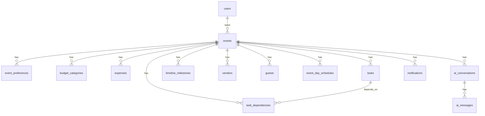

# UtsavAI - Database & Data Model Specification

**Version:** 1.0
**Status:** Draft
**Product:** UtsavAI
**Source documents:** `01-PRD.md`, `02-FRS.md`, `03-NFR.md`
**Purpose:** Define database structure and data relationships for UtsavAI.
**Intended audience:** Backend developers, database administrators, architects, QA

---

## 1. Document Information

- **Document name:** 04-DATABASE.md
- **Product:** UtsavAI
- **Version:** 1.0
- **Status:** Draft
- **Source documents:** `01-PRD.md`, `02-FRS.md`, `03-NFR.md`
- **Purpose:** Define database structure and data relationships
- **Intended audience:** Backend, database, QA

---

## 2. Database Principles

- PostgreSQL
- Relational data model
- Strong relationships
- Referential integrity
- User ownership
- Server-side authorization
- Validation before persistence
- Timestamps
- Consistent naming
- Avoid unnecessary duplication
- Avoid unnecessary denormalization
- Production data must not depend on browser-only state

---

## 3. Core Entities

Core entities required by UtsavAI:

- User
- Event
- Event Preferences
- Budget Category
- Expense
- Task
- Task Dependency
- Timeline Milestone
- Vendor
- Guest
- Event-Day Schedule
- AI Conversation
- AI Message
- Notification

Do not add entities not required by PRD/FRS.

---

## 4. USERS

### User Entity

- Primary key: `id`
- Unique constraint: `email`

Suggested fields:

- `id` (UUID, PK)
- `name` (required)
- `email` (required, unique, validated)
- `created_at` (required)
- `updated_at` (required)

### Authentication Relationship

- Supabase Auth manages credentials.
- Application user data lives separately from Supabase Auth.
- Application user references Supabase Auth `user_id`.

### Ownership

- User has many events.
- Event belongs to one user.

---

## 5. EVENTS

### Event Entity

- Primary key: `id` (UUID, PK)
- Foreign key: `user_id` → User

Fields:

| Field | Required | Type | Notes |
|---|---|---|---|
| `id` | Yes | UUID | PK |
| `user_id` | Yes | UUID | FK → User |
| `name` | Yes | String | Event name |
| `type` | Yes | Enum | Wedding, Birthday, Community Event, Custom |
| `description` | No | Text | |
| `event_date` | Yes | Date | Must be valid |
| `start_time` | No | Time | |
| `end_time` | No | Time | Must be after start time |
| `location` | No | String | |
| `guest_count` | No | Integer | Non-negative |
| `total_budget` | No | Decimal | Non-negative |

### Constraints

- Event belongs to exactly one user.
- User may have multiple events.

### Event Types

- Wedding
- Birthday
- Community Event
- Family Celebration (FRS includes Family Celebration)
- Custom Event

PRD lists: Wedding, Birthday, Community Event, Family Celebration, Custom Event.

---

## 6. EVENT PREFERENCES

### Event Preferences Entity

- Primary key: `id` (UUID, PK)
- Foreign key: `event_id` → Event

Fields:

- `id`
- `event_id`
- `theme`
- `style`
- `priorities`
- `special_requirements`

### OPEN DECISION

- `priorities` representation not specified in PRD/FRS.
- Use simplest MVP approach, likely structured JSON or normalized text.

---

## 7. BUDGET CATEGORIES

### Budget Category Entity

- Primary key: `id` (UUID, PK)
- Foreign key: `event_id` → Event

Fields:

- `id`
- `event_id`
- `name`
- `planned_amount`
- `created_at`
- `updated_at`

Suggested categories (examples):

- Venue
- Food
- Decoration
- Photography
- Entertainment
- Transportation
- Security
- Other

---

## 8. EXPENSES

### Expense Entity

- Primary key: `id` (UUID, PK)
- Foreign key: `event_id` → Event
- Foreign key: `category_id` → Budget Category

Fields:

| Field | Required | Notes |
|---|---|---|
| `id` | Yes | UUID, PK |
| `event_id` | Yes | FK → Event |
| `category_id` | No | FK → Budget Category |
| `description` | Yes | Text |
| `planned_amount` | Yes | Decimal, non-negative |
| `actual_amount` | Yes | Decimal, non-negative |
| `date` | Yes | Date, valid |
| `notes` | No | Text |

### Constraints

- Amounts cannot be negative.
- Expense must belong to event.
- Financial calculations performed by application logic.

---

## 9. TASKS

### Task Entity

- Primary key: `id` (UUID, PK)
- Foreign key: `event_id` → Event

Fields:

| Field | Required | Notes |
|---|---|---|
| `id` | Yes | UUID, PK |
| `event_id` | Yes | FK → Event |
| `title` | Yes | Text |
| `description` | No | Text |
| `category` | No | Text |
| `priority` | Yes | Enum: Low, Medium, High, Critical |
| `status` | Yes | Enum: Not Started, In Progress, Completed |
| `due_date` | No | Date |
| `created_at` | Yes | Timestamp |
| `updated_at` | Yes | Timestamp |

### Task Statuses

- Not Started
- In Progress
- Completed

### Task Priorities

- Low
- Medium
- High
- Critical

### Overdue Behavior

- Task past due date and not completed → overdue state.

---

## 10. TASK DEPENDENCIES

### Task Dependency Entity

- Primary key: `id` (UUID, PK)
- Foreign key: `task_id` → Task (task that depends)
- Foreign key: `depends_on_task_id` → Task (prerequisite task)

### Relationships

- Task A depends on Task B.
- Creating dependency supported.
- Removing dependency supported.

### Validation

- No self-dependency.
- No circular dependencies.

---

## 11. TIMELINE MILESTONES

### Timeline Milestone Entity

- Primary key: `id` (UUID, PK)
- Foreign key: `event_id` → Event

Fields:

| Field | Required | Notes |
|---|---|---|
| `id` | Yes | UUID, PK |
| `event_id` | Yes | FK → Event |
| `title` | Yes | Text |
| `date` | Yes | Date |
| `description` | No | Text |
| `status` | No | Text |

### Ordering

- Milestones have ordering by date.

---

## 12. VENDORS

### Vendor Entity

- Primary key: `id` (UUID, PK)
- Foreign key: `event_id` → Event

Fields:

| Field | Required | Notes |
|---|---|---|
| `id` | Yes | UUID, PK |
| `event_id` | Yes | FK → Event |
| `name` | Yes | Text |
| `category` | Yes | Enum: Venue, Catering, Photography, Decoration, Music, Transportation, Security, Entertainment, Other |
| `contact` | No | Text |
| `estimated_cost` | No | Decimal |
| `actual_cost` | No | Decimal |
| `status` | Yes | Enum: Researching, Shortlisted, Contacted, Negotiating, Booked, Completed, Cancelled |
| `notes` | No | Text |
| `booking_date` | No | Date |

### Statuses

- Researching
- Shortlisted
- Contacted
- Negotiating
- Booked
- Completed
- Cancelled

---

## 13. GUESTS

### Guest Entity

- Primary key: `id` (UUID, PK)
- Foreign key: `event_id` → Event

Fields:

| Field | Required | Notes |
|---|---|---|
| `id` | Yes | UUID, PK |
| `event_id` | Yes | FK → Event |
| `name` | Yes | Text |
| `group_name` | No | Text |
| `contact` | No | Text |
| `rsvp_status` | Yes | Enum: Pending, Accepted, Declined |
| `meal_preference` | No | Text |
| `special_requirements` | No | Text |
| `notes` | No | Text |

### RSVP

- Pending
- Accepted
- Declined

---

## 14. EVENT-DAY SCHEDULE

### Event-Day Schedule Entity

- Primary key: `id` (UUID, PK)
- Foreign key: `event_id` → Event

Fields:

| Field | Required | Notes |
|---|---|---|
| `id` | Yes | UUID, PK |
| `event_id` | Yes | FK → Event |
| `activity` | Yes | Text |
| `scheduled_time` | Yes | Time |
| `description` | No | Text |
| `responsible_vendor_id` | No | FK → Vendor |
| `responsible_person` | No | Text |
| `created_at` | Yes | Timestamp |
| `updated_at` | Yes | Timestamp |

### Ordering

- Chronological ordering by `scheduled_time`.

---

## 15. AI CONVERSATIONS

### AI Conversation Entity

- Primary key: `id` (UUID, PK)
- Foreign key: `event_id` → Event
- Foreign key: `user_id` → User

Fields:

- `id`
- `event_id`
- `user_id`
- `created_at`
- `updated_at`

---

## 16. AI MESSAGES

### AI Message Entity

- Primary key: `id` (UUID, PK)
- Foreign key: `conversation_id` → AI Conversation

Fields:

| Field | Required | Notes |
|---|---|---|
| `id` | Yes | UUID, PK |
| `conversation_id` | Yes | FK → AI Conversation |
| `role` | Yes | Enum: user, assistant, system |
| `content` | Yes | Text |
| `created_at` | Yes | Timestamp |

### Storage Policy

- System prompts not exposed to normal users.
- Model metadata, token usage, error status only if useful for MVP.

---

## 17. NOTIFICATIONS

### Notification Entity

- Primary key: `id` (UUID, PK)
- Foreign key: `user_id` → User
- Foreign key: `event_id` → Event

Fields:

| Field | Required | Notes |
|---|---|---|
| `id` | Yes | UUID, PK |
| `user_id` | Yes | FK → User |
| `event_id` | Yes | FK → Event |
| `type` | Yes | Text |
| `title` | Yes | Text |
| `message` | Yes | Text |
| `priority` | No | Text |
| `read` | Yes | Boolean |
| `created_at` | Yes | Timestamp |

### Types

- Task overdue
- Budget warning
- Vendor warning
- RSVP warning
- Task completed
- Vendor booked
- Plan generated
- Plan accepted

---

## 18. ENTITY RELATIONSHIPS

### ER Diagram (Mermaid)



---

## 19. RELATIONSHIP RULES

### User → Events

- One user may have many events.
- One event belongs to one user.

### Event → Tasks

- One event may have many tasks.

### Event → Vendors

- One event may have many vendors.

### Event → Guests

- One event may have many guests.

### Event → Expenses

- One event may have many expenses.

### Event → Timeline Milestones

- One event may have many milestones.

### Event → Event-Day Schedule

- One event may have many schedule entries.

### Event → AI Conversations

- One event may have multiple conversations.

### Conversation → Messages

- One conversation may have many messages.

### User → Notifications

- One user may receive many notifications.

---

## 20. OWNERSHIP AND AUTHORIZATION

Ownership model:

- A user can only access their own events.
- Event data inherits ownership from event.

Data:

- Tasks belonging to user's events.
- Vendors belonging to user's events.
- Guests belonging to user's events.
- Expenses belonging to user's events.
- Timeline milestones belonging to user's events.
- Event-day schedules belonging to user's events.
- AI conversations belonging to user's events.
- AI messages belonging to user's conversations.
- User notifications.

Backend/database-level authorization must enforce ownership.

Do not rely on frontend filtering only.

---

## 21. ROW LEVEL SECURITY

Target database: Supabase PostgreSQL.

Requirements:

- RLS must be enabled for user-owned data.
- Policies must prevent cross-user access.
- Users can read their own event data.
- Users can insert data only for events they own.
- Users can update/delete only data belonging to their events.
- Notifications visible only to owner.

Do not write actual SQL policies in this document.

Only define requirements.

---

## 22. DELETE BEHAVIOR

When an event is deleted:

Child records include:

- Tasks
- Task dependencies
- Vendors
- Guests
- Expenses
- Timeline milestones
- Event-day schedules
- AI conversations
- Notifications

Strategy:

- Choose cascade deletion where safe.
- Maintain referential integrity.

OPEN DECISION:

- Exact delete behavior not specified in PRD/FRS.

---

## 23. DATA VALIDATION

Database-level constraints where appropriate:

- Required fields cannot be null.
- Budget values cannot be negative.
- Expense amounts cannot be negative.
- Guest counts cannot be negative.
- Event dates must be valid.
- Foreign keys must reference valid records.
- Enum-like statuses must use supported values.
- Unique constraints prevent accidental duplicates where appropriate.

Do not move all validation into database.

Application validation and database constraints complement each other.

---

## 24. TIMESTAMP STRATEGY

- `created_at` required.
- `updated_at` required.

Use consistent timestamp convention.

OPEN DECISION:

- Exact timezone handling policy not specified.

---

## 25. INDEXING

Recommended indexes:

- `events.user_id`
- `tasks.event_id`
- `tasks.due_date`
- `vendors.event_id`
- `guests.event_id`
- `expenses.event_id`
- `timeline_milestones.event_id`
- `event_day_schedules.event_id`
- `ai_conversations.event_id`
- `ai_messages.conversation_id`
- `notifications.user_id`
- `notifications.read`

Do not add indexes without query/use-case justification.

---

## 26. FINANCIAL DATA

- Store monetary precision.
- Avoid floating-point for authoritative financial amounts.
- Application calculates:

  - Remaining Budget
  - Budget Utilization
  - Variance
  - Warnings

Database stores source values.

Application performs calculations.

---

## 27. AI-GENERATED DATA

Flow:

```text
AI
↓
Structured response
↓
Schema validation
↓
Business validation
↓
User review
↓
User acceptance
↓
Persistence
```

AI must never directly execute unrestricted database mutations.

Generated tasks, milestones, budget allocations, and recommendations must be traceable to accepted plan where practical.

---

## 28. DEMO DATA VS PRODUCTION DATA

- Development/demo data: for frontend demonstration.
- Production data: actual database data for authenticated users.

Production UI must not confuse demo metrics with real user data.

---

## 29. DATABASE MIGRATION REQUIREMENTS

- Versioned migrations.
- Safe schema changes.
- Development database.
- Production database.
- Rollback considerations.
- Environment separation.

Do not generate actual migrations.

---

## 30. BACKUP AND RECOVERY

Document database backup expectations based on selected Supabase tier.

Do not promise capabilities not guaranteed by tier.

OPEN DECISION:

- Backup requirements not fully specified.

---

## 31. DATA LIFECYCLE

Creation, update, deletion for:

- User
- Event
- Task
- Expense
- Vendor
- Guest
- AI conversation
- Notification

Include ownership, retention considerations.

Do not invent legal retention requirements.

---

## 32. DATABASE TRACEABILITY

| FRS Requirement | Database Entity | Relevant Fields | Relationship |
|---|---|---|---|
| FR-AUTH-001 | users | id, name, email, created_at, updated_at | user → event |
| FR-EVENT-001 | events | id, user_id, name, type, event_date, guest_count, total_budget | user → event |
| FR-BUDGET-001 | budget_categories, expenses | event_id, category_id, planned_amount, actual_amount | event → category → expense |
| FR-EXPENSE-001 | expenses | event_id, category_id, planned_amount, actual_amount, date | event → expense |
| FR-TASK-001 | tasks | event_id, title, priority, status, due_date | event → task |
| FR-TASK-006 | task_dependencies | task_id, depends_on_task_id | task → task |
| FR-TIMELINE-001 | timeline_milestones | event_id, title, date | event → milestone |
| FR-VENDOR-001 | vendors | event_id, name, category, status | event → vendor |
| FR-GUEST-001 | guests | event_id, name, rsvp_status | event → guest |
| FR-SCHEDULE-001 | event_day_schedules | event_id, activity, scheduled_time | event → schedule |
| FR-AI-001 | ai_conversations, ai_messages | event_id, conversation_id, role, content | event → conversation → message |
| FR-NOTIFY-001 | notifications | user_id, event_id, type, read | user → event → notification |
| FR-DASH-001 | events, expenses, tasks, vendors, guests, notifications | aggregate queries | event → child data |

---

## 33. MVP DATABASE SCOPE

### MVP

- users
- events
- event_preferences
- budget_categories
- expenses
- tasks
- task_dependencies
- timeline_milestones
- vendors
- guests
- event_day_schedules
- ai_conversations
- ai_messages
- notifications

### Post-MVP

- Advanced reporting tables
- Advanced notification preferences
- Audit logs

### Future

- Vendor marketplace
- Vendor payments
- Social features

---

## 34. FINAL DATABASE CHECKLIST

### Schema

- [ ] Core entities defined
- [ ] Relationships defined
- [ ] Primary keys defined
- [ ] Foreign keys defined
- [ ] Constraints defined

### Security

- [ ] Ownership model defined
- [ ] RLS requirements defined
- [ ] Cross-user access prevented

### Data Integrity

- [ ] Financial precision defined
- [ ] Validation defined
- [ ] Delete behavior defined
- [ ] Timestamps defined

### AI

- [ ] AI conversation model defined
- [ ] AI message model defined
- [ ] AI-generated data validation defined
- [ ] AI cannot directly mutate database

### Deployment

- [ ] PostgreSQL target defined
- [ ] Supabase target defined
- [ ] Migration requirements defined
- [ ] Backup expectations documented

Do not mark anything `[x]` unless source documents prove it is already implemented.

---

## 35. OPEN DECISIONS

- Event preferences priorities representation.
- Timezone handling policy.
- Delete behavior for event hierarchy.
- Backup requirements specifics.

Use:

`OPEN DECISION`

Do not hide uncertainty.

---

## QUALITY RULES

- Professional
- Precise
- Developer-readable
- Backend-readable
- QA-readable
- Consistent with PRD, FRS, NFR
- Relational
- Secure
- Free of unnecessary complexity
- Free of implementation code
- Free of invented product requirements

The `docs` folder is the single location for project documentation.

Save the final document as:

```text
docs/04-DATABASE.md
```

Do not modify application source code.

IMPORTANT PROJECT RULE:

**AI must never perform Git commit or Git push operations. Git commit and Git push will always be performed manually by the project owner.**
