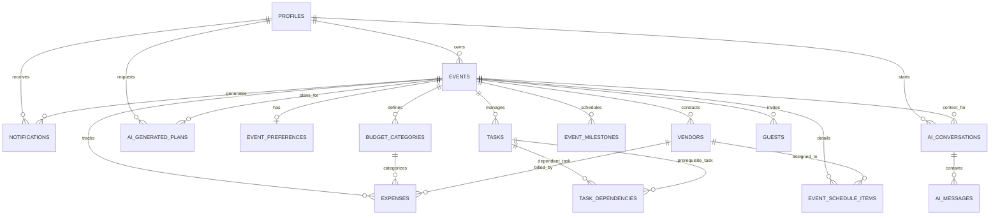

# UtsavAI - Database Implementation & Supabase Schema Specification

**Document name:** 13-DATABASE-IMPLEMENTATION-SPECIFICATION.md  
**Version:** 1.0  
**Status:** Draft  
**Product:** UtsavAI  
**Source documents:** `01-PRD.md`, `02-FRS.md`, `04-DATABASE.md`, `05-API-SPECIFICATION.md`, `08-SECURITY-AUTHORIZATION-SPECIFICATION.md`, `11-API-IMPLEMENTATION-SPECIFICATION.md`, `12-TECHNICAL-ARCHITECTURE-SPECIFICATION.md`  
**Purpose:** Define the concrete database implementation blueprint and Supabase schema specification for UtsavAI, establishing tables, fields, constraints, relationships, indexing, Row Level Security (RLS) policies, and data integrity rules.  
**Intended audience:** Backend developers, database administrators, security engineers, QA.

---

## DOCUMENT SCOPE

This document defines the database architecture, schema definitions, constraints, indexes, RLS policies, and lifecycle rules for UtsavAI on Supabase PostgreSQL.

It does NOT modify application source code.  
It does NOT execute SQL commands against Supabase.  
It does NOT create migration files in the codebase.  
It does NOT run Git commit or push operations.

Unresolved design decisions are explicitly documented as `OPEN DECISION`.

---

## 1. DATABASE OBJECTIVE

UtsavAI requires a robust, scalable, yet lightweight relational database architecture deployable on the **Supabase (PostgreSQL) Free Tier**.

The database architecture must support:
- Multi-tenant isolation across multiple authenticated users
- Multiple events per user
- Detailed event customization preferences
- Budget planning and expense tracking with category hierarchies
- Task management and directed task dependencies
- High-level timeline milestones
- Granular event-day run-of-show schedules
- Vendor discovery, cost evaluation, and booking status tracking
- Guest lists, RSVP status tracking, and dietary/meal requirements
- User-targeted in-app notifications
- AI conversation history and message persistence
- Transient review storage for structured AI-generated event plans

### Architecture Style: Relational & Normalized (MVP)

All core application state is strictly modeled using normalized relational tables within PostgreSQL.

**Excluded Technologies:**
- No MongoDB or document stores
- No Redis (caching or transient state stays in-process or within database tables)
- No Elasticsearch (PostgreSQL `B-tree` and text search suffice for MVP)
- No distributed microservice databases (single unified Supabase PostgreSQL instance)

---

## 2. DATABASE PRINCIPLES

1. **PostgreSQL as the Single Source of Truth**: Persistent application state resides solely in the database. Client state (React state, Zustand) is purely a transient presentation cache.
2. **Strict User Ownership**: Every root record maps directly to an authenticated Supabase Auth identity (`auth.users.id`).
3. **Scoped Child Resources**: Every child entity (task, expense, guest, vendor, milestone, schedule) must maintain an explicit foreign key reference to its parent `event_id`.
4. **Enforced Referential Integrity**: Foreign key constraints with explicit `ON DELETE` cascade behaviors prevent orphan records.
5. **Targeted Indexing**: Indexes must be created for foreign keys, common filter predicates, sort keys, and uniqueness constraints—without unneeded indexing overhead.
6. **Consistent Timestamps**: All entities track `created_at` and `updated_at` using timezone-aware timestamps (`TIMESTAMPTZ` with `DEFAULT NOW()`).
7. **Exact Monetary Storage**: Financial amounts must never use floating-point types (`REAL`, `FLOAT`, `DOUBLE PRECISION`). Use `NUMERIC(12, 2)` to eliminate rounding errors.
8. **Enforced Enums & Domain Integrity**: Controlled statuses and types must be constrained at the database layer (via `CHECK` constraints or Postgres `ENUM` types).
9. **Mandatory Row Level Security (RLS)**: RLS is enabled on every user-owned table as a defense-in-depth security boundary.
10. **Principle of Least Privilege**: Client applications communicate via the Supabase client using anonymous public keys constrained by RLS. The privileged `service_role` key remains strictly server-side.

---

## 3. USER / PROFILE MODEL

### Separation of Concerns: Supabase Auth vs Application Data

- **Supabase Auth (`auth.users`)**: Manages secure password hashing, JWT signing, refresh tokens, session lifecycles, and email verification. The application never directly alters `auth.users` tables.
- **Application Profiles (`public.profiles`)**: Contains public or application-specific user metadata tied 1:1 with `auth.users.id`.

### Table: `profiles`

| Column | Type | Nullable | Default | Constraints / Notes |
|---|---|---|---|---|
| `id` | `UUID` | No | None | Primary Key, References `auth.users(id) ON DELETE CASCADE` |
| `full_name` | `VARCHAR(200)` | Yes | `NULL` | User display name |
| `avatar_url` | `TEXT` | Yes | `NULL` | Public avatar image URL |
| `created_at` | `TIMESTAMPTZ` | No | `NOW()` | Audit creation timestamp |
| `updated_at` | `TIMESTAMPTZ` | No | `NOW()` | Audit modification timestamp |

**Implementation Rules:**
- Created automatically via a database trigger listening on `auth.users` `AFTER INSERT`, or created by the application during initial onboarding.
- The `profiles.id` directly matches `auth.uid()`.

---

## 4. EVENTS TABLE

The `events` table is the central domain entity. All event planning activities, child resources, and financial tracking stem from an event.

### Table: `events`

| Column | Type | Nullable | Default | Constraints / Notes |
|---|---|---|---|---|
| `id` | `UUID` | No | `gen_random_uuid()` | Primary Key |
| `user_id` | `UUID` | No | None | FK → `profiles(id)` or `auth.users(id) ON DELETE CASCADE` |
| `name` | `VARCHAR(200)` | No | None | Event title, length: 1–200 characters |
| `type` | `VARCHAR(50)` | No | None | `CHECK (type IN ('Wedding', 'Birthday', 'Community Event', 'Family Celebration', 'Custom Event'))` |
| `description` | `TEXT` | Yes | `NULL` | Optional detailed description |
| `event_date` | `DATE` | No | None | Calendar date of event |
| `start_time` | `TIME` | Yes | `NULL` | Planned start time |
| `end_time` | `TIME` | Yes | `NULL` | Planned end time (`CHECK (end_time IS NULL OR start_time IS NULL OR end_time > start_time)`) |
| `location` | `VARCHAR(300)` | Yes | `NULL` | Venue or city/state location string |
| `guest_count` | `INTEGER` | Yes | `0` | Expected headcount (`CHECK (guest_count >= 0)`) |
| `total_budget` | `NUMERIC(12, 2)` | Yes | `0.00` | Target financial budget (`CHECK (total_budget >= 0)`) |
| `currency` | `VARCHAR(10)` | No | `'INR'` | ISO currency code (default: INR) |
| `status` | `VARCHAR(30)` | No | `'Planning'` | `CHECK (status IN ('Planning', 'Active', 'Completed', 'Cancelled'))` |
| `created_at` | `TIMESTAMPTZ` | No | `NOW()` | Creation audit timestamp |
| `updated_at` | `TIMESTAMPTZ` | No | `NOW()` | Update audit timestamp |

**Indexes:**
- `CREATE INDEX idx_events_user_id ON events(user_id);`
- `CREATE INDEX idx_events_event_date ON events(event_date);`

---

## 5. EVENT PREFERENCES

The `event_preferences` table holds cultural, stylistic, aesthetic, and priority configurations used by the application and provided to the AI Context Builder.

### Table: `event_preferences`

| Column | Type | Nullable | Default | Constraints / Notes |
|---|---|---|---|---|
| `id` | `UUID` | No | `gen_random_uuid()` | Primary Key |
| `event_id` | `UUID` | No | None | Unique FK → `events(id) ON DELETE CASCADE` |
| `theme` | `VARCHAR(200)` | Yes | `NULL` | Visual/cultural theme (e.g., "Royal Rajasthani", "Minimalist Modern") |
| `style` | `VARCHAR(200)` | Yes | `NULL` | Atmosphere/style (e.g., "Traditional", "Contemporary", "Formal") |
| `priorities` | `JSONB` | Yes | `'[]'::jsonb` | Ordered array or key-value object of user priorities |
| `special_requirements` | `TEXT` | Yes | `NULL` | Accessibility, dietary constraints, customs |
| `created_at` | `TIMESTAMPTZ` | No | `NOW()` | Audit timestamp |
| `updated_at` | `TIMESTAMPTZ` | No | `NOW()` | Audit timestamp |

**Design Decision for `priorities`:**
- **Selected Approach**: `JSONB` array (e.g., `["Photography", "Catering", "Decor"]`).
- **Rationale**: `JSONB` provides schema flexibility for ranking arbitrary priorities without requiring an additional normalized child table or strict migrations as user preference structures evolve, while maintaining simple serialization for the AI Context Builder.

---

## 6. BUDGET CATEGORIES

Budget categories allow users and the AI planner to partition total event funds across distinct functional departments.

### Table: `budget_categories`

| Column | Type | Nullable | Default | Constraints / Notes |
|---|---|---|---|---|
| `id` | `UUID` | No | `gen_random_uuid()` | Primary Key |
| `event_id` | `UUID` | No | None | FK → `events(id) ON DELETE CASCADE` |
| `name` | `VARCHAR(100)` | No | None | Category name (e.g., 'Venue', 'Catering', 'Decor') |
| `planned_amount` | `NUMERIC(12, 2)` | No | `0.00` | Target allocation (`CHECK (planned_amount >= 0)`) |
| `created_at` | `TIMESTAMPTZ` | No | `NOW()` | Audit timestamp |
| `updated_at` | `TIMESTAMPTZ` | No | `NOW()` | Audit timestamp |

**Constraints:**
- Composite Unique Constraint: `UNIQUE(event_id, name)` — Prevents accidental duplicate categories within the same event.

**Indexes:**
- `CREATE INDEX idx_budget_categories_event_id ON budget_categories(event_id);`

---

## 7. EXPENSES

The `expenses` table records actual expenditures and commitments against an event and optionally against a budget category.

### Table: `expenses`

| Column | Type | Nullable | Default | Constraints / Notes |
|---|---|---|---|---|
| `id` | `UUID` | No | `gen_random_uuid()` | Primary Key |
| `event_id` | `UUID` | No | None | FK → `events(id) ON DELETE CASCADE` |
| `category_id` | `UUID` | Yes | `NULL` | FK → `budget_categories(id) ON DELETE SET NULL` |
| `vendor_id` | `UUID` | Yes | `NULL` | FK → `vendors(id) ON DELETE SET NULL` |
| `description` | `VARCHAR(500)` | No | None | Expense item or milestone payment summary |
| `planned_amount` | `NUMERIC(12, 2)` | Yes | `0.00` | Initial estimated cost (`CHECK (planned_amount >= 0)`) |
| `actual_amount` | `NUMERIC(12, 2)` | No | `0.00` | Final or paid cost (`CHECK (actual_amount >= 0)`) |
| `expense_date` | `DATE` | No | `CURRENT_DATE` | Date payment occurred or is due |
| `notes` | `TEXT` | Yes | `NULL` | Payment reference, invoice notes, or receipts |
| `created_at` | `TIMESTAMPTZ` | No | `NOW()` | Audit timestamp |
| `updated_at` | `TIMESTAMPTZ` | No | `NOW()` | Audit timestamp |

**Cross-Event Reference Prevention:**
To ensure `category_id` belongs to the exact same `event_id`, application-level validation verifies matching `event_id` prior to insert/update. At the database layer, a composite foreign key can optionally enforce `FOREIGN KEY (event_id, category_id) REFERENCES budget_categories(event_id, id)`.

**Indexes:**
- `CREATE INDEX idx_expenses_event_id ON expenses(event_id);`
- `CREATE INDEX idx_expenses_category_id ON expenses(category_id);`
- `CREATE INDEX idx_expenses_date ON expenses(event_id, expense_date);`

---

## 8. TASKS

The `tasks` table stores planning action items, deadlines, and execution statuses.

### Table: `tasks`

| Column | Type | Nullable | Default | Constraints / Notes |
|---|---|---|---|---|
| `id` | `UUID` | No | `gen_random_uuid()` | Primary Key |
| `event_id` | `UUID` | No | None | FK → `events(id) ON DELETE CASCADE` |
| `title` | `VARCHAR(300)` | No | None | Action item description |
| `description` | `TEXT` | Yes | `NULL` | Context, checklists, links |
| `category` | `VARCHAR(100)` | Yes | `NULL` | Logical department (e.g., 'Catering', 'Logistics') |
| `priority` | `VARCHAR(20)` | No | `'Medium'` | `CHECK (priority IN ('Low', 'Medium', 'High', 'Critical'))` |
| `status` | `VARCHAR(30)` | No | `'Not Started'` | `CHECK (status IN ('Not Started', 'In Progress', 'Completed'))` |
| `due_date` | `DATE` | Yes | `NULL` | Target completion date |
| `assigned_to` | `VARCHAR(200)` | Yes | `NULL` | Responsible person or family member name |
| `notes` | `TEXT` | Yes | `NULL` | Operational notes |
| `created_at` | `TIMESTAMPTZ` | No | `NOW()` | Audit timestamp |
| `updated_at` | `TIMESTAMPTZ` | No | `NOW()` | Audit timestamp |

**Indexes:**
- `CREATE INDEX idx_tasks_event_id ON tasks(event_id);`
- `CREATE INDEX idx_tasks_event_status ON tasks(event_id, status);`
- `CREATE INDEX idx_tasks_event_due_date ON tasks(event_id, due_date);`

---

## 9. TASK DEPENDENCIES

The `task_dependencies` table implements a directed graph representing prerequisite workflows (e.g., "Book Venue" must complete before "Send Invitations").

### Table: `task_dependencies`

| Column | Type | Nullable | Default | Constraints / Notes |
|---|---|---|---|---|
| `id` | `UUID` | No | `gen_random_uuid()` | Primary Key |
| `task_id` | `UUID` | No | None | FK → `tasks(id) ON DELETE CASCADE` (dependent task) |
| `depends_on_task_id` | `UUID` | No | None | FK → `tasks(id) ON DELETE CASCADE` (prerequisite task) |
| `created_at` | `TIMESTAMPTZ` | No | `NOW()` | Audit timestamp |

**Database Constraints:**
- `CHECK (task_id <> depends_on_task_id)`: Prevents self-dependency.
- `UNIQUE (task_id, depends_on_task_id)`: Prevents duplicate dependency edges.

**Circular Dependency Handling:**
Circular dependencies (e.g., A → B → C → A) cannot be efficiently checked using simple static declarative database table constraints without recursive triggers. Therefore, cycle detection is enforced deterministically by the application layer (`lib/calculations/` or task service using Depth-First Search / topological sorting) before inserting dependency records into the database.

---

## 10. TIMELINE MILESTONES

High-level planning milestones track macroscopic event countdown checkpoints (e.g., "Finalize Guest Count - 30 Days Out").

### Table: `event_milestones`

| Column | Type | Nullable | Default | Constraints / Notes |
|---|---|---|---|---|
| `id` | `UUID` | No | `gen_random_uuid()` | Primary Key |
| `event_id` | `UUID` | No | None | FK → `events(id) ON DELETE CASCADE` |
| `title` | `VARCHAR(300)` | No | None | Milestone title |
| `milestone_date` | `DATE` | No | None | Target checkpoint date |
| `description` | `TEXT` | Yes | `NULL` | Scope of the milestone |
| `status` | `VARCHAR(30)` | No | `'Pending'` | `CHECK (status IN ('Pending', 'Completed', 'Overdue'))` |
| `created_at` | `TIMESTAMPTZ` | No | `NOW()` | Audit timestamp |
| `updated_at` | `TIMESTAMPTZ` | No | `NOW()` | Audit timestamp |

**Indexes:**
- `CREATE INDEX idx_milestones_event_date ON event_milestones(event_id, milestone_date);`

---

## 11. EVENT-DAY SCHEDULE

The `event_schedule_items` table manages the granular, chronological "run of show" for the day of the event.

### Table: `event_schedule_items`

| Column | Type | Nullable | Default | Constraints / Notes |
|---|---|---|---|---|
| `id` | `UUID` | No | `gen_random_uuid()` | Primary Key |
| `event_id` | `UUID` | No | None | FK → `events(id) ON DELETE CASCADE` |
| `activity` | `VARCHAR(300)` | No | None | Scheduled activity title (e.g., "Guest Arrival & Welcome Drinks") |
| `start_time` | `TIME` | No | None | Scheduled start time |
| `end_time` | `TIME` | Yes | `NULL` | Scheduled finish time |
| `description` | `TEXT` | Yes | `NULL` | Execution details and requirements |
| `location` | `VARCHAR(200)` | Yes | `NULL` | Specific room, hall, or stage |
| `responsible_person` | `VARCHAR(200)` | Yes | `NULL` | MC, coordinator, or point-of-contact |
| `responsible_vendor_id`| `UUID` | Yes | `NULL` | FK → `vendors(id) ON DELETE SET NULL` |
| `sort_order` | `INTEGER` | No | `0` | Sequence order for manual reordering |
| `created_at` | `TIMESTAMPTZ` | No | `NOW()` | Audit timestamp |
| `updated_at` | `TIMESTAMPTZ` | No | `NOW()` | Audit timestamp |

**Distinction from Milestones:**
- `event_milestones`: Long-term preparatory planning dates weeks or months ahead of the event.
- `event_schedule_items`: Minute-by-minute itinerary during the actual day of celebration.

**Indexes:**
- `CREATE INDEX idx_schedule_items_event_time ON event_schedule_items(event_id, start_time, sort_order);`

---

## 12. VENDORS

The `vendors` table tracks suppliers, quotes, negotiation statuses, and contracts across service categories.

### Table: `vendors`

| Column | Type | Nullable | Default | Constraints / Notes |
|---|---|---|---|---|
| `id` | `UUID` | No | `gen_random_uuid()` | Primary Key |
| `event_id` | `UUID` | No | None | FK → `events(id) ON DELETE CASCADE` |
| `name` | `VARCHAR(200)` | No | None | Company or vendor individual name |
| `category` | `VARCHAR(50)` | No | None | `CHECK (category IN ('Venue', 'Catering', 'Photography', 'Decoration', 'Music', 'Transportation', 'Security', 'Entertainment', 'Other'))` |
| `contact_name` | `VARCHAR(200)` | Yes | `NULL` | Primary point of contact |
| `contact_phone` | `VARCHAR(50)` | Yes | `NULL` | Contact phone number |
| `contact_email` | `VARCHAR(255)` | Yes | `NULL` | Contact email address |
| `website` | `VARCHAR(500)` | Yes | `NULL` | Portfolio or website URL |
| `quoted_price` | `NUMERIC(12, 2)` | Yes | `0.00` | Initial quote (`CHECK (quoted_price >= 0)`) |
| `agreed_price` | `NUMERIC(12, 2)` | Yes | `0.00` | Negotiated/contracted price (`CHECK (agreed_price >= 0)`) |
| `status` | `VARCHAR(30)` | No | `'Researching'` | `CHECK (status IN ('Researching', 'Shortlisted', 'Contacted', 'Negotiating', 'Booked', 'Completed', 'Cancelled'))` |
| `booking_date` | `DATE` | Yes | `NULL` | Date contract finalized |
| `notes` | `TEXT` | Yes | `NULL` | Vendor deliverable details |
| `created_at` | `TIMESTAMPTZ` | No | `NOW()` | Audit timestamp |
| `updated_at` | `TIMESTAMPTZ` | No | `NOW()` | Audit timestamp |

**Indexes:**
- `CREATE INDEX idx_vendors_event_id ON vendors(event_id);`
- `CREATE INDEX idx_vendors_category ON vendors(event_id, category);`
- `CREATE INDEX idx_vendors_status ON vendors(event_id, status);`

---

## 13. GUESTS

The `guests` table records invited individuals, family clusters, responses, and hospitality requirements.

### Table: `guests`

| Column | Type | Nullable | Default | Constraints / Notes |
|---|---|---|---|---|
| `id` | `UUID` | No | `gen_random_uuid()` | Primary Key |
| `event_id` | `UUID` | No | None | FK → `events(id) ON DELETE CASCADE` |
| `name` | `VARCHAR(200)` | No | None | Primary guest name |
| `group_name` | `VARCHAR(100)` | Yes | `NULL` | Family/table cluster (e.g., "Groom's Family", "College Friends") |
| `email` | `VARCHAR(255)` | Yes | `NULL` | Guest email address |
| `phone` | `VARCHAR(50)` | Yes | `NULL` | Guest phone number |
| `rsvp_status` | `VARCHAR(20)` | No | `'Pending'` | `CHECK (rsvp_status IN ('Pending', 'Accepted', 'Declined'))` |
| `plus_one` | `BOOLEAN` | No | `FALSE` | Indicates accompanying attendee |
| `meal_preference` | `VARCHAR(100)` | Yes | `NULL` | Diet preference (e.g., "Vegetarian", "Jain", "Vegan") |
| `special_requirements` | `TEXT` | Yes | `NULL` | Accessibility or lodging notes |
| `notes` | `TEXT` | Yes | `NULL` | General notes |
| `created_at` | `TIMESTAMPTZ` | No | `NOW()` | Audit timestamp |
| `updated_at` | `TIMESTAMPTZ` | No | `NOW()` | Audit timestamp |

**Indexes:**
- `CREATE INDEX idx_guests_event_id ON guests(event_id);`
- `CREATE INDEX idx_guests_rsvp ON guests(event_id, rsvp_status);`
- `CREATE INDEX idx_guests_group ON guests(event_id, group_name);`

---

## 14. NOTIFICATIONS

The `notifications` table delivers scoped in-app alerts, budget risk warnings, task deadlines, and AI status messages.

### Table: `notifications`

| Column | Type | Nullable | Default | Constraints / Notes |
|---|---|---|---|---|
| `id` | `UUID` | No | `gen_random_uuid()` | Primary Key |
| `user_id` | `UUID` | No | None | FK → `profiles(id)` or `auth.users(id) ON DELETE CASCADE` |
| `event_id` | `UUID` | Yes | `NULL` | FK → `events(id) ON DELETE CASCADE` |
| `type` | `VARCHAR(50)` | No | None | Notification category |
| `title` | `VARCHAR(200)` | No | None | Alert summary |
| `message` | `TEXT` | No | None | Full alert explanation |
| `is_read` | `BOOLEAN` | No | `FALSE` | Read/unread flag |
| `created_at` | `TIMESTAMPTZ` | No | `NOW()` | Audit timestamp |

**Notification Types:**
- `budget_warning`: Expenses crossed 80% threshold
- `budget_critical`: Expenses crossed 90% threshold
- `task_overdue`: Task passed due date
- `task_due`: Task due within 48 hours
- `vendor_warning`: Critical vendor unbooked near event date
- `rsvp_reminder`: Unconfirmed guest headcount checkpoint
- `ai_plan_generated`: Structured plan ready for review
- `ai_plan_accepted`: AI plan imported to event
- `system`: General platform notification

**Indexes:**
- `CREATE INDEX idx_notifications_user_read ON notifications(user_id, is_read);`
- `CREATE INDEX idx_notifications_created_at ON notifications(user_id, created_at DESC);`

---

## 15. AI CONVERSATIONS

The `ai_conversations` table maintains scoped chat session metadata for the natural-language planning assistant.

### Table: `ai_conversations`

| Column | Type | Nullable | Default | Constraints / Notes |
|---|---|---|---|---|
| `id` | `UUID` | No | `gen_random_uuid()` | Primary Key |
| `user_id` | `UUID` | No | None | FK → `auth.users(id) ON DELETE CASCADE` |
| `event_id` | `UUID` | No | None | FK → `events(id) ON DELETE CASCADE` |
| `title` | `VARCHAR(200)` | No | `'Event Planning Chat'` | Conversation thread title |
| `created_at` | `TIMESTAMPTZ` | No | `NOW()` | Audit timestamp |
| `updated_at` | `TIMESTAMPTZ` | No | `NOW()` | Audit timestamp |

**Indexes:**
- `CREATE INDEX idx_ai_conversations_event ON ai_conversations(event_id);`
- `CREATE INDEX idx_ai_conversations_user ON ai_conversations(user_id);`

---

## 16. AI MESSAGES

The `ai_messages` table stores individual prompt exchanges within a conversation thread.

### Table: `ai_messages`

| Column | Type | Nullable | Default | Constraints / Notes |
|---|---|---|---|---|
| `id` | `UUID` | No | `gen_random_uuid()` | Primary Key |
| `conversation_id` | `UUID` | No | None | FK → `ai_conversations(id) ON DELETE CASCADE` |
| `role` | `VARCHAR(20)` | No | None | `CHECK (role IN ('user', 'assistant', 'system'))` |
| `content` | `TEXT` | No | None | Plaintext message content |
| `created_at` | `TIMESTAMPTZ` | No | `NOW()` | Audit timestamp |

**Storage & Privacy Policy:**
- Storing internal system instructions in user message records is prohibited to avoid exposing prompt templates.
- Secret credentials (`GEMINI_API_KEY`) must never be recorded in `content`.
- When loading chat context for Gemini, only the most recent N messages are queried (ordered by `created_at ASC`) to bound token usage.

**Indexes:**
- `CREATE INDEX idx_ai_messages_conv_created ON ai_messages(conversation_id, created_at ASC);`

---

## 17. AI GENERATED PLAN STORAGE

Generated plans are structured proposals that must be reviewed and accepted by the user before writing to authoritative application tables.

### Table: `ai_generated_plans`

| Column | Type | Nullable | Default | Constraints / Notes |
|---|---|---|---|---|
| `id` | `UUID` | No | `gen_random_uuid()` | Primary Key |
| `event_id` | `UUID` | No | None | FK → `events(id) ON DELETE CASCADE` |
| `user_id` | `UUID` | No | None | FK → `auth.users(id) ON DELETE CASCADE` |
| `plan_data` | `JSONB` | No | None | Structured payload (tasks, milestones, budget) |
| `model` | `VARCHAR(100)`| No | `'gemini-1.5-flash'`| Model tag used for generation |
| `status` | `VARCHAR(30)` | No | `'Draft'` | `CHECK (status IN ('Draft', 'Accepted', 'Discarded'))` |
| `created_at` | `TIMESTAMPTZ` | No | `NOW()` | Audit timestamp |

### Authoritative Boundary Rule:
1. `ai_generated_plans` is a staging and history table only.
2. The core application (Dashboard, Tasks, Budget views) queries normalized tables (`tasks`, `budget_categories`, `event_milestones`), never `plan_data` directly.
3. Upon acceptance (`POST /api/ai/plans/:id/accept`), application logic extracts validated items from `plan_data`, performs relational inserts into the application tables within a transaction, and marks `status = 'Accepted'`.

---

## 18. RELATIONSHIP MODEL

### Entity-Relationship Diagram



---

## 19. FOREIGN KEY STRATEGY

To prevent orphaned records and maintain referential integrity, foreign key cascading is enforced at the database level:

| Parent Table | Child Table | Foreign Key Column | `ON DELETE` Action | Rationale |
|---|---|---|---|---|
| `auth.users` | `profiles` | `id` | `CASCADE` | User account deletion purges profile |
| `auth.users` | `events` | `user_id` | `CASCADE` | Purges all events owned by user |
| `events` | `event_preferences` | `event_id` | `CASCADE` | Preferences exist only for parent event |
| `events` | `budget_categories` | `event_id` | `CASCADE` | Categories tied exclusively to event |
| `events` | `expenses` | `event_id` | `CASCADE` | Expenses tied exclusively to event |
| `budget_categories` | `expenses` | `category_id` | `SET NULL` | Deleting category retains expense record |
| `vendors` | `expenses` | `vendor_id` | `SET NULL` | Deleting vendor retains historical expense |
| `events` | `tasks` | `event_id` | `CASCADE` | Tasks tied exclusively to event |
| `tasks` | `task_dependencies`| `task_id` | `CASCADE` | Dependency invalid if dependent task deleted |
| `tasks` | `task_dependencies`| `depends_on_task_id`| `CASCADE` | Dependency invalid if prerequisite deleted |
| `events` | `event_milestones` | `event_id` | `CASCADE` | Milestones tied exclusively to event |
| `events` | `event_schedule_items`| `event_id`| `CASCADE` | Schedule tied exclusively to event |
| `vendors` | `event_schedule_items`| `responsible_vendor_id`| `SET NULL`| Deleting vendor retains schedule slot |
| `events` | `vendors` | `event_id` | `CASCADE` | Vendors tied exclusively to event |
| `events` | `guests` | `event_id` | `CASCADE` | Guest records tied exclusively to event |
| `events` | `notifications` | `event_id` | `CASCADE` | Event-scoped alerts purged with event |
| `events` | `ai_conversations` | `event_id` | `CASCADE` | Event chats purged with event |
| `ai_conversations` | `ai_messages` | `conversation_id` | `CASCADE` | Purges all messages in conversation |
| `events` | `ai_generated_plans`| `event_id` | `CASCADE` | Draft plans purged with event |

---

## 20. INDEX STRATEGY

The indexing strategy focuses on high-frequency predicates (RLS ownership filters, foreign key joins, chronological ordering, and dashboard queries).

| Table | Index Columns | Purpose |
|---|---|---|
| `events` | `(user_id)` | RLS verification & user dashboard listing |
| `events` | `(event_date)` | Upcoming event calendar queries |
| `budget_categories` | `(event_id)` | Category list for budget page |
| `expenses` | `(event_id)` | RLS checks & total expense calculation |
| `expenses` | `(event_id, expense_date)` | Filtering by billing date range |
| `expenses` | `(category_id)` | Category breakdown aggregation |
| `tasks` | `(event_id)` | RLS checks & task list queries |
| `tasks` | `(event_id, status)` | Filtering active vs completed tasks |
| `tasks` | `(event_id, due_date)` | Overdue task detection & timeline display |
| `task_dependencies` | `(task_id)` | Loading dependencies for a task |
| `task_dependencies` | `(depends_on_task_id)` | Identifying downstream dependents |
| `event_milestones` | `(event_id, milestone_date)`| Chronological milestone progression |
| `event_schedule_items`| `(event_id, start_time)` | Chronological run-of-show itinerary |
| `vendors` | `(event_id, category)` | Vendor filtering by category |
| `vendors` | `(event_id, status)` | Unbooked/critical vendor detection |
| `guests` | `(event_id, rsvp_status)` | Headcount calculation & RSVP filter |
| `guests` | `(event_id, group_name)` | Group-based seating / guest grouping |
| `notifications` | `(user_id, is_read)` | Fast query for unread bell badge count |
| `notifications` | `(user_id, created_at DESC)`| Chronological notification feed |
| `ai_conversations` | `(event_id, user_id)` | Locating active chat session for an event |
| `ai_messages` | `(conversation_id, created_at ASC)`| Sequential conversation history retrieval |

---

## 21. RLS STRATEGY

Supabase Row Level Security (RLS) is mandatory on all public schema tables.

### Authorization Model

The authorization model relies on two primary conditions:
1. **Direct User Ownership**: The table contains a direct `user_id` referencing `auth.uid()`.
2. **Inherited Event Ownership**: The table contains `event_id` and is authorized by verifying that the referenced `events` record has `user_id = auth.uid()`.

### Subquery Pattern for Child Entities

For any child resource with `event_id`:
```sql
-- Concept for SELECT / UPDATE / DELETE on child resources:
EXISTS (
  SELECT 1 FROM public.events
  WHERE public.events.id = [child_table].event_id
    AND public.events.user_id = auth.uid()
)
```

**Security Invariant:** Even if an attacker guesses or intercepts a UUID belonging to another user's task, guest, or vendor, the database rejects the query because the joined parent event does not match `auth.uid()`.

---

## 22. RLS POLICY MATRIX

| Table | SELECT Policy | INSERT Policy | UPDATE Policy | DELETE Policy | Ownership Rule |
|---|---|---|---|---|---|
| `profiles` | `id = auth.uid()` | `id = auth.uid()` | `id = auth.uid()` | Disallowed | Direct user match |
| `events` | `user_id = auth.uid()` | `user_id = auth.uid()` | `user_id = auth.uid()` | `user_id = auth.uid()` | Direct owner match |
| `event_preferences` | Via parent `event.user_id` | Via parent `event.user_id` | Via parent `event.user_id` | Via parent `event.user_id` | Inherited from event |
| `budget_categories` | Via parent `event.user_id` | Via parent `event.user_id` | Via parent `event.user_id` | Via parent `event.user_id` | Inherited from event |
| `expenses` | Via parent `event.user_id` | Via parent `event.user_id` | Via parent `event.user_id` | Via parent `event.user_id` | Inherited from event |
| `tasks` | Via parent `event.user_id` | Via parent `event.user_id` | Via parent `event.user_id` | Via parent `event.user_id` | Inherited from event |
| `task_dependencies` | Via parent task's event | Via parent task's event | Via parent task's event | Via parent task's event | Inherited from task |
| `event_milestones` | Via parent `event.user_id` | Via parent `event.user_id` | Via parent `event.user_id` | Via parent `event.user_id` | Inherited from event |
| `event_schedule_items`| Via parent `event.user_id` | Via parent `event.user_id` | Via parent `event.user_id` | Via parent `event.user_id` | Inherited from event |
| `vendors` | Via parent `event.user_id` | Via parent `event.user_id` | Via parent `event.user_id` | Via parent `event.user_id` | Inherited from event |
| `guests` | Via parent `event.user_id` | Via parent `event.user_id` | Via parent `event.user_id` | Via parent `event.user_id` | Inherited from event |
| `notifications` | `user_id = auth.uid()` | Disallowed (server-only) | `user_id = auth.uid()` | `user_id = auth.uid()` | Direct user match |
| `ai_conversations` | `user_id = auth.uid()` | `user_id = auth.uid()` | `user_id = auth.uid()` | `user_id = auth.uid()` | Direct owner match |
| `ai_messages` | Via conv `user_id = auth.uid()` | Via conv `user_id = auth.uid()` | Disallowed (append-only) | Via conv `user_id = auth.uid()` | Inherited from conversation |
| `ai_generated_plans` | `user_id = auth.uid()` | `user_id = auth.uid()` | `user_id = auth.uid()` | `user_id = auth.uid()` | Direct owner match |

---

## 23. AUTH USER ID RULE

**Mandatory Rule:** Client-provided `user_id` values in request bodies or query strings are untrusted and must never be used directly in database operations.

```text
INCORRECT:
INSERT INTO events (user_id, name) VALUES (request.body.user_id, 'My Wedding');

CORRECT:
-- In Next.js Server Route / Server Action:
const { data: { user } } = await supabase.auth.getUser();
if (!user) throw new UnauthorizedError();
-- Explicitly bind authenticated session identity:
INSERT INTO events (user_id, name) VALUES (user.id, validatedData.name);
```

In Supabase RLS `WITH CHECK` clauses, default assignments can leverage `auth.uid()` directly.

---

## 24. DATA INTEGRITY

Database integrity constraints complement application-level Zod schemas:

| Constraint Type | Target Tables & Fields | Enforced Rule |
|---|---|---|
| **Non-Negative Amounts** | `events.total_budget`, `budget_categories.planned_amount`, `expenses.actual_amount`, `vendors.quoted_price` | `CHECK (amount >= 0)` |
| **Non-Negative Count** | `events.guest_count` | `CHECK (guest_count >= 0)` |
| **Valid Time Order** | `events(start_time, end_time)` | `CHECK (end_time > start_time)` |
| **Controlled Enums** | `events.type`, `events.status`, `tasks.priority`, `tasks.status`, `vendors.category`, `vendors.status`, `guests.rsvp_status`, `ai_messages.role` | Strict `CHECK IN (...)` lists |
| **No Self-Dependency** | `task_dependencies` | `CHECK (task_id <> depends_on_task_id)` |
| **Unique Dependency** | `task_dependencies` | `UNIQUE(task_id, depends_on_task_id)` |
| **Unique Category Name** | `budget_categories` | `UNIQUE(event_id, name)` |

---

## 25. MONEY HANDLING

### Strict Exact Numeric Types
All financial and budgetary figures use `NUMERIC(12, 2)`:
- Allows amounts up to 9,999,999,999.99 (9.99 Billion), comfortably exceeding event planning needs.
- Preserves exact cents / paise with zero binary floating-point drift.

### Currency Rules
- Default project currency: `'INR'` (₹ Indian Rupee).
- Currency is stored as an ISO string at the `events` table level (`events.currency`).
- Multi-currency conversion or live exchange rates are **POST-MVP**.
- In API serialization, amounts are emitted as numbers with fixed 2-decimal formatting.

---

## 26. DATE / TIME HANDLING

| Domain | Storage Type | Example / Format | Notes |
|---|---|---|---|
| Audit Timestamps | `TIMESTAMPTZ` | `2026-10-26T21:49:09.123Z` | Stored in UTC |
| Calendar Dates | `DATE` | `2026-12-15` | Local calendar date without timezone shift |
| Day Schedule Times | `TIME` | `14:30:00` | Wall-clock time on event day |

**Timezone Policy:**
Event planning occurs in the timezone of the celebration venue. Calendar dates (`event_date`, `due_date`, `milestone_date`) are stored as pure SQL `DATE` values to avoid accidental off-by-one day conversions caused by browser timezone offsets.

---

## 27. DATABASE TRANSACTIONS

Operations involving multiple interrelated entity creations must execute atomically using PostgreSQL transactions or Supabase RPC stored procedures.

### Primary Atomic Journey: Accept AI Plan

When a user accepts an AI-generated event plan:
```text
BEGIN TRANSACTION;
  1. Validate event ownership for auth.uid().
  2. Bulk INSERT into `tasks`.
  3. Bulk INSERT into `budget_categories`.
  4. Bulk INSERT into `event_milestones`.
  5. Bulk INSERT into `event_schedule_items`.
  6. INSERT into `notifications` (type: 'ai_plan_accepted').
  7. UPDATE `ai_generated_plans` SET status = 'Accepted' WHERE id = plan_id;
COMMIT;
```

**Implementation Strategy:**
- Implemented via a Next.js server service coordinating a transaction via Supabase Client RPC / function or a sequence with rollback compensation.
- If any insert fails validation, the entire batch rolls back, preventing partial plans from corrupting user data.

---

## 28. SEED / DEMO DATA

### Development Seed Dataset
Safe, standardized demo records must be available for local development and preview environments:

1. **Wedding Celebration ("Aarav & Diya Wedding")**
   - Type: `Wedding`
   - Budget: `₹15,00,000.00`
   - Guest Count: `350`
   - Categories: Venue, Catering, Decor, Photography, Outfits
   - Sample tasks across Not Started, In Progress, and Completed

2. **Milestone Birthday ("Vikram's 50th Birthday")**
   - Type: `Birthday`
   - Budget: `₹1,50,000.00`
   - Guest Count: `60`

3. **Diwali Community Gala ("Shanti Nagar Diwali Utsav")**
   - Type: `Community Event`
   - Budget: `₹3,00,000.00`
   - Guest Count: `500`

**Data Separation Rule:**
Seed scripts execute only in `development` or `preview` environments. No seed records or fake customer metrics are injected into `production`.

---

## 29. DATABASE MIGRATION STRATEGY

### Tooling: Supabase CLI / Versioned SQL Migrations
- Schema changes are authored as timestamped SQL files within a `supabase/migrations/` directory.
- Format: `YYYYMMDDHHMMSS_name.sql`.

### Migration Workflow:
```text
1. Developer writes declarative migration SQL locally.
2. Verified against local Supabase container (supabase db reset / test).
3. Code reviewed and approved in Pull Request.
4. Project Owner manually applies migration to staging/production via Supabase CLI or Dashboard.
```

**Zero Manual Drift:** Direct modifications to production schemas via Supabase Studio UI without matching migration files are strictly prohibited.

---

## 30. BACKUP / RECOVERY

| Capability | Supabase Free Tier | Production Requirement |
|---|---|---|
| **Point-in-Time Recovery (PITR)** | Not available | Post-MVP (Requires Pro Plan) |
| **Automated Daily Backups** | Included (7-day retention) | Core backup foundation |
| **Manual Schema & Data Dumps** | Supported via `pg_dump` CLI | Pre-deployment manual safeguard |

**Disaster Recovery Protocol:**
Prior to major schema migrations, a manual snapshot dump (`pg_dump`) must be performed using the Supabase connection string.

---

## 31. PRIVACY / DATA RETENTION

1. **Contact Information Minimization**: Guest emails, guest phone numbers, and vendor private contact details are retained only for the planning lifecycle.
2. **Account Deletion Cascade**: Triggering user account deletion completely purges all associated records (`events`, `tasks`, `expenses`, `guests`, `vendors`, `notifications`, `conversations`) via database foreign key cascades.
3. **No Third-Party Tracking in Database**: IP addresses, location coordinates, and browser fingerprints are not stored in the database.

---

## 32. AI DATA PRIVACY

| Data Element | Sent to Gemini? | Stored in Database? | Privacy Safeguard |
|---|---|---|---|
| Event Name, Date, Type | Yes | Yes (`events`) | Contextual planning input |
| Aggregate Headcount | Yes | Yes (`events.guest_count`) | Summarized integer only |
| Guest Names | No | Yes (`guests.name`) | Stripped by Context Builder |
| Guest Emails / Phone Numbers | **NEVER** | Yes (`guests`) | **Strictly excluded** from AI context |
| Budget Overview Totals | Yes | Yes (`events.total_budget`) | High-level planning context |
| API Keys / Session Tokens | **NEVER** | **NEVER** | Excluded from context and DB |
| Generated Draft Plan | Output | Yes (`ai_generated_plans`) | Staged as draft until user accepts |

---

## 33. DATABASE PERFORMANCE

To maintain fast sub-second responses on the Supabase Free Tier:
1. **Index-Driven Reads**: All queries must filter by indexed columns (`user_id`, `event_id`, `created_at`).
2. **Pagination on Large Collections**: `guests`, `tasks`, and `expenses` queries enforce `LIMIT` (default 50, max 100) and `OFFSET` to prevent heavy memory allocations.
3. **Column Projection**: Avoid wildcard `SELECT *` in domain services; query only required fields.
4. **No Unbounded Aggregations in UI Loops**: Budget totals are computed in single SQL aggregation queries (`SUM(actual_amount)`), not client-side loops over thousands of rows.

---

## 34. DATABASE SECURITY CHECKLIST

- [ ] Supabase Auth configured and active
- [ ] RLS enabled on all 15 public schema tables
- [ ] RLS policies verified to prevent cross-user IDOR access
- [ ] Foreign keys established with appropriate `ON DELETE` cascade actions
- [ ] `NUMERIC(12, 2)` used for all financial amounts
- [ ] `CHECK` constraints enforced for all enums and non-negative numbers
- [ ] `service_role` key restricted strictly to server-side code
- [ ] No API keys, passwords, or plain secrets stored in tables
- [ ] Timestamps standardized as `TIMESTAMPTZ` with `NOW()` defaults
- [ ] Cascade deletion tested for event deletion hierarchy
- [ ] Database indexes created for all foreign keys and filter paths

---

## 35. DATABASE TEST MATRIX

| Area | Test Scenario | Expected Result | Priority |
|---|---|---|---|
| **Multi-Tenancy** | User A queries User B's events via direct ID | Returns 0 rows (RLS blocks access) | Critical |
| **Multi-Tenancy** | User A queries User B's guests or tasks | Returns 0 rows (RLS blocks access) | Critical |
| **Multi-Tenancy** | User A tries to insert task with User B's `event_id` | RLS `WITH CHECK` rejects insert | Critical |
| **Data Integrity** | Insert expense with negative `actual_amount` | DB constraint violation error | High |
| **Data Integrity** | Insert task with invalid status string | DB constraint violation error | High |
| **Data Integrity** | Insert task dependency where `task_id = depends_on_task_id` | DB check constraint rejects self-dependency | High |
| **Data Integrity** | Insert duplicate task dependency | Unique constraint rejects duplicate | Medium |
| **Data Integrity** | Insert duplicate budget category name in same event | Unique constraint rejects duplicate | Medium |
| **Cascade Deletion**| Delete parent `event` | Automatically deletes child tasks, guests, vendors, expenses | Critical |
| **Cascade Deletion**| Delete parent `task` with dependencies | Automatically deletes referencing `task_dependencies` | High |
| **Transactions** | AI Plan Acceptance encounters invalid milestone | Entire batch rolls back; no orphan tasks created | Critical |
| **Audit Trails** | Update event record | `updated_at` reflects modification timestamp | Medium |

---

## 36. FINAL SCHEMA SUMMARY

| Table | Purpose | Ownership | Primary Key | Key Foreign Relationships |
|---|---|---|---|---|
| `profiles` | User profile & display metadata | `auth.users.id` | `id (UUID)` | `id` → `auth.users(id)` |
| `events` | Core event entity | `user_id` | `id (UUID)` | `user_id` → `profiles(id)` |
| `event_preferences` | Cultural & aesthetic preferences | Inherited (`event_id`) | `id (UUID)` | `event_id` → `events(id)` |
| `budget_categories` | Planned financial buckets | Inherited (`event_id`) | `id (UUID)` | `event_id` → `events(id)` |
| `expenses` | Actual line-item expenses | Inherited (`event_id`) | `id (UUID)` | `event_id` → `events(id)`, `category_id` → `budget_categories(id)` |
| `tasks` | Action items and checklists | Inherited (`event_id`) | `id (UUID)` | `event_id` → `events(id)` |
| `task_dependencies` | Task workflow graph edges | Inherited (`tasks`) | `id (UUID)` | `task_id` → `tasks(id)`, `depends_on_task_id` → `tasks(id)` |
| `event_milestones` | Planning countdown checkpoints | Inherited (`event_id`) | `id (UUID)` | `event_id` → `events(id)` |
| `event_schedule_items`| Event-day chronological run of show | Inherited (`event_id`) | `id (UUID)` | `event_id` → `events(id)`, `responsible_vendor_id` → `vendors(id)` |
| `vendors` | Service vendors & status tracking | Inherited (`event_id`) | `id (UUID)` | `event_id` → `events(id)` |
| `guests` | Headcount, RSVP, and preferences | Inherited (`event_id`) | `id (UUID)` | `event_id` → `events(id)` |
| `notifications` | User in-app alerts and risk flags | `user_id` | `id (UUID)` | `user_id` → `profiles(id)`, `event_id` → `events(id)` |
| `ai_conversations` | Assistant chat threads | `user_id` | `id (UUID)` | `user_id` → `profiles(id)`, `event_id` → `events(id)` |
| `ai_messages` | Chat messages in a thread | Inherited (`conv_id`) | `id (UUID)` | `conversation_id` → `ai_conversations(id)` |
| `ai_generated_plans` | Staged draft plans before acceptance | `user_id` | `id (UUID)` | `event_id` → `events(id)`, `user_id` → `profiles(id)` |

---

## 37. OPEN DATABASE DECISIONS

The following implementation-level decisions remain open for final configuration:

| # | Open Decision | Options | Recommended Approach |
|---|---|---|---|
| **ODB-01** | Cross-Event Category Foreign Key | Static check vs Composite FK | Enforce in application service layer for MVP; optionally add composite FK `(event_id, id)` |
| **ODB-02** | Automatic Profile Creation | Database Trigger vs Next.js Auth Hook | PostgreSQL Trigger on `auth.users AFTER INSERT` is cleaner and ensures zero missing profile rows |
| **ODB-03** | Soft Delete vs Hard Delete | Soft delete (`deleted_at`) vs Hard SQL `DELETE` | Hard Delete with Cascade for MVP simplicity; soft deletes add substantial query complexity to all RLS policies |
| **ODB-04** | AI Generated Plan Retention | Retain indefinitely vs Purge after 30 days | Retain accepted/discarded plans for audit trail during MVP; implement purge job Post-MVP |
| **ODB-05** | Guest Plus-One Data Model | Simple boolean flag vs dedicated guest row | Boolean flag (`plus_one: boolean`) is sufficient for MVP headcount calculations |

---

## FINAL PROJECT RULES

1. **PostgreSQL on Supabase is the sole authoritative database.**
2. **Supabase Auth manages all identities; the application never stores passwords.**
3. **Row Level Security (RLS) is strictly enabled on all application tables.**
4. **Client-provided `user_id` values are never trusted.**
5. **Every event child resource must reference its parent `event_id`.**
6. **Financial amounts strictly use `NUMERIC(12, 2)`—floating-point types are prohibited.**
7. **AI-generated plans must be reviewed and accepted before writing to core application tables.**
8. **Keep the schema simple, clean, and normalized for the MVP.**
9. **No Redis, MongoDB, or auxiliary databases.**
10. **Never commit secrets or credentials into the database or repository.**
11. **Do not create fake metrics or mock data in production.**
12. **AI must never execute `git commit` or `git push` commands.**
13. **All Git commits and pushes are performed manually by the project owner.**

